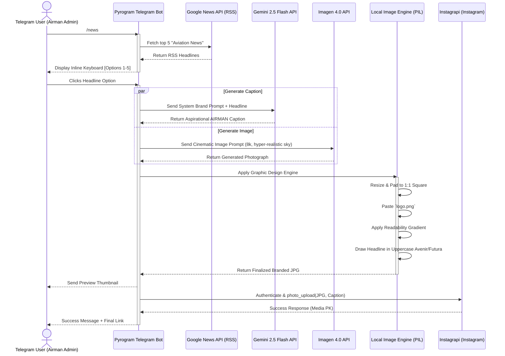

# High-Level Architecture

The **AIRMAN Social Media Automation Bot** follows an orchestrated pipeline pattern. The core engine is triggered by a Telegram user, acts as an autonomous agent connecting various Google services (for News, Generative Text, and Generative Imaging), processes the assets locally using Pillow, and finally publishes the result directly to Instagram's mobile API.

## System Pipeline Visualization

## Component Breakdown

**1. Command Gateway (Telegram)**
*   Provides the primary user interface.
*   Handles stateless inline callbacks asynchronously (`CallbackQueryHandler`).
*   Stores temporary headline state in `context.user_data`.

**2. Content Sourcing (Feedparser)**
*   Bypasses complex scraping by parsing standardized Google News RSS feeds for "aviation news", returning clean plaintext headlines.

**3. Cognitive Engine (Google Gen AI SDK)**
*   **System Prompting**: Employs rigorous system instructions telling Gemini to adopt an educational, tech-forward, Apple-like brand tone for AIRMAN.
*   **Parallel Execution**: Image generation (`imagen-4.0-generate-001`) and Text generation (`gemini-2.5-flash`) run concurrently via `asyncio.get_event_loop().run_in_executor` so the bot does not block other user commands while waiting.

**4. Visual Branding Engine (Pillow)**
*   Replicates a professional graphic designer pipeline:
    *   **Padding**: Prevents `BadRequest('Image_process_failed')` on Instagram by ensuring exactly 1:1 aspect ratios regardless of what the AI produced.
    *   **Brand Overlay**: Composites the external `logo.png` file using alpha channels. 
    *   **Smart Typography**: Falls back aggressively (`Avenir` -> `Futura` -> `Arial`) to maintain high-quality Apple-native typography styles. Lifts the text intelligently using `textwrap` based on character widths.

**5. Distribution (Instagrapi)**
*   A reverse-engineered Instagram mobile client. Used entirely for the `photo_upload` payload, mimicking a real iOS device publishing a post. 
